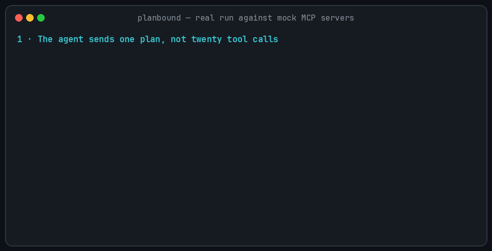
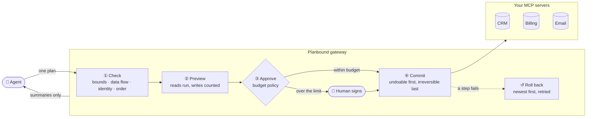
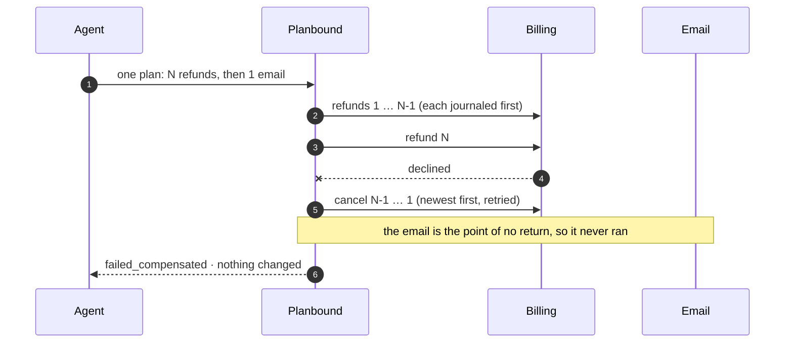
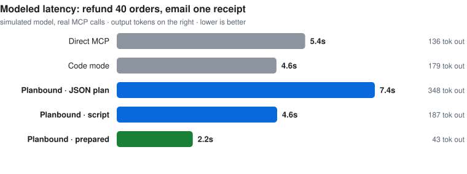

<div align="center">

# Planbound

**Prepared statements and sagas for MCP agent actions.**<br>
*AI agents don't need a babysitter. They need a budget.*

[](https://github.com/gowtham16-bhu/planbound/actions/workflows/ci.yml)




<sub>A real run against the mock MCP servers: every number on screen comes from it (<a href="docs/demo/make_demo.py">docs/demo/make_demo.py</a>).</sub>

</div>

---

Your agent is about to refund 40 orders and email a customer. **What will it touch? What if
refund #17 fails? What if a support note says "ignore your instructions"?**

Planbound sits between the agent and your existing MCP servers. Instead of twenty tool calls, the
agent sends **one bounded plan**, and Planbound:

| | |
|---|---|
| 🧱 **Checks it** | before anything runs: bounds, data flow, who it may act on, a safe order |
| 🔍 **Previews it** | runs only the reads and shows the exact impact: *"9 refunds · ₹20,750 · 1 email"* |
| ✍️ **Gets it approved** | by a budget policy that signs; a human only when a plan is over the limit |
| ↺ **Commits it as a saga** | undoable steps first, the point of no return last, rolled back if anything fails |
| 🛡️ **Answers in numbers** | the model sees counts, sums and ids computed by code, never raw text from your tools |

Your MCP servers don't change.

## How it works



## A plan, in ten lines

Plans are written as a small subset of Python syntax. Planbound **parses it, never runs it**, and
turns it into a checked plan:

```python
# goal: refund C-42's overdue orders under 5000 without disputes, email one receipt
cust     = crm.get_customer(customer_id="C-42")
orders   = billing.list_orders(customer_id="C-42", status="overdue")
disputes = billing.list_disputes(customer_id="C-42")
eligible = filter(orders.orders, item.amount < 5000 and item.order_id not in disputes.order_ids)
refunds  = map(eligible, billing.refund_order(order_id=item.order_id, amount=item.amount), max_items=20)
notify   = email.send_email(to=cust.email, template="refund_processed",
                            vars={"count": count(eligible), "total": sum(eligible, "amount")},
                            after=[refunds])
return eligible, refunds, notify
```

What comes back is numbers, not text. With `max_items=50` the compiler refuses instead:
*worst case 500,000 is above the per-plan limit 200,000; lower max_items to at most 20.*

Doing the same task every day? Prepare it once with `param.*` placeholders, then
`planbound_run("refund_overdue", {"customer": "C-42", "max_amount": 5000})` costs about 40 output
tokens, with every check, preview and approval still applied.

<details>
<summary>The same plan as JSON (also accepted)</summary>

```json
{"planbound": "0.1", "goal": "Refund eligible overdue orders, then email one receipt",
 "nodes": [
  {"id": "cust", "op": "call", "tool": "crm.get_customer", "args": {"customer_id": "C-42"}},
  {"id": "orders", "op": "call", "tool": "billing.list_orders",
   "args": {"customer_id": {"$ref": "cust.customer_id"}, "status": "overdue"}},
  {"id": "disputes", "op": "call", "tool": "billing.list_disputes", "args": {"customer_id": "C-42"}},
  {"id": "eligible", "op": "filter", "input": {"$ref": "orders.orders"},
   "where": {"and": [{"lt": [{"$item": "amount"}, 5000]},
                     {"not": {"in": [{"$item": "order_id"}, {"$ref": "disputes.order_ids"}]}}]}},
  {"id": "refunds", "op": "map", "input": {"$ref": "eligible"}, "max_items": 20,
   "call": {"tool": "billing.refund_order",
            "args": {"order_id": {"$item": "order_id"}, "amount": {"$item": "amount"}}}},
  {"id": "notify", "op": "call", "tool": "email.send_email", "depends_on": ["refunds"],
   "args": {"to": {"$ref": "cust.email"}, "template": "refund_processed",
            "vars": {"count": {"$agg": {"fn": "count", "of": "eligible"}},
                     "total": {"$agg": {"fn": "sum", "of": "eligible", "field": "amount"}}}}}
 ]}
```
</details>

## When something fails



Crashes, lost answers, a stalled gateway and an undo service that is down are all handled too, and
each has a fault-injection test: see [What it guarantees](#what-it-guarantees).

## Fast enough to use by default

<picture>
  <source media="(prefers-color-scheme: dark)" srcset="docs/demo/latency-dark.svg">
  
</picture>

| Refund 40 orders, email one receipt | Direct MCP | Code mode | Planbound · script | Planbound · prepared |
|---|---|---|---|---|
| LLM turns | 4 | 2 | 2 | 2 |
| Tokens the model reads | 8,213 | **1,497** | 1,873 | 1,766 |
| Tokens the model writes | 136 | 179 | 187 | **43** |
| Injected note reaches the model | ❌ yes | ⚠️ only if the script prints it | ✅ never | ✅ never |
| One refund fails mid-batch | ❌ 1 refund left done | ❌ 1 refund left done | ✅ nothing changed | ✅ nothing changed |
| Modeled latency | 5.4s | 4.6s | 4.6s | **2.2s** |

<sub>Simulated model, real MCP calls; direct calling gets every advantage (parallel calls, server-side
filters). The prepared row is a repeat run. Full tables: <a href="bench/RESULTS.md">bench/RESULTS.md</a>.
<code>bench/live.py</code> measures the same with a real Claude model.</sub>

## What it guarantees

<details open>
<summary><b>🛡️ What the model can see, and what it can do</b></summary>

| Risk | What Planbound does |
|---|---|
| Prompt injection through tool output | Untrusted text never reaches the model; it gets counts, sums, ids |
| A quarantined reader steered by injected text | Several readers must agree, and writes driven by a reader always need a human |
| Poisoned or changed tool descriptions | Tool contracts are hash-pinned; the model sees operator-reviewed descriptions |
| Acting on the wrong person | Identity binding: `employee_id` must be `caller.employee_id` |
| Approval fatigue, or the agent approving itself | A budget policy signs (Ed25519, separate process); humans only at the edge |
| Many small plans to dodge a limit | The signer keeps a rolling budget with authorization holds |
</details>

<details>
<summary><b>💸 How much it touches</b></summary>

| Risk | What Planbound does |
|---|---|
| "How much will this touch?" | Every `map` declares `max_items`; per-call and per-plan cost limits, checked statically and on real data |
| Two irreversible actions half-done | Compile error: at most one point of no return, after every undoable step |
| A refund visible before it is rolled back | Reservations (`confirm`): held invisibly, confirmed only past the point of no return |
| An email sent too soon | `hold_seconds`: a cancel window before irreversible steps (`planbound cancel`) |
| Money moving without upstream guarantees | `strict_writes`: sensitive tools must declare idempotency keys, conditional writes and fencing |
| An upstream that only *claims* those guarantees | `planbound verify` tests each claim; `require_verified` demands proof |
</details>

<details>
<summary><b>↺ When things go wrong</b></summary>

| Risk | What Planbound does |
|---|---|
| Refund #17 fails after #1–16 ran | Automatic compensation in reverse order |
| An undo step fails during rollback | Retried with backoff; `planbound recover` keeps retrying later |
| An undo service down for hours | Background reconciliation finishes the rollback when it is back; alerts if it stays stuck |
| Starting writes while the undo service is down | `undo_probe`: the plan does not start |
| A write gets no answer | Re-sent only if that cannot repeat it; `outcome_check` asks the server; otherwise a person decides, never a guess |
| Gateway crash mid-plan | SQLite journal + idempotency keys; `planbound recover` compensates or rolls forward |
</details>

<details>
<summary><b>⏱️ Races and concurrency</b></summary>

| Risk | What Planbound does |
|---|---|
| Data changed while waiting for approval | The commit re-reads; a mismatch stops with `E_PREVIEW_STALE`, nothing written |
| Data changes between the re-read and the write | `conditional` writes carry the version read earlier; the server refuses → rolled back |
| `recover` racing a live gateway, or two commits of one plan | Plan leases: one driver at a time |
| A stalled gateway waking up after recovery took over | Fencing tokens: the journal and fencing-aware servers refuse the old holder |
| Investigations that decide what to look at next | Multi-stage plans: each stage continues from earlier results with `checkpoint` |
</details>

Some limits cannot be removed by any gateway (an email cannot be unsent). [SPEC.md §6](SPEC.md)
lists each one next to the defence that handles it.

## Quick start

```bash
uv sync --all-groups
uv run pytest -q                  # 127 tests, incl. fault injection
uv run python -m bench.run        # writes bench/RESULTS.md
uv run python -m bench.demo_setup # writes demo/: config, pinned manifest, signing keys
```

Run the gateway (point any MCP client at it) and the policy signer in another terminal:

```bash
uv run planbound --config demo/planbound.config.json serve
```

```bash
uv run planbound --config demo/planbound.config.json signer --keys demo/keys --budget 50000
```

<details>
<summary><b>Agent tools and CLI commands</b></summary>

**Tools the agent sees:** `planbound_search_tools`, `planbound_submit_plan` (script or JSON),
`planbound_prepare`, `planbound_run`, `planbound_commit`, `planbound_cancel`,
`planbound_inspect_handle`.

| Command | What it does |
|---|---|
| `planbound serve` | Run the gateway as an MCP server on stdio |
| `planbound signer --budget N` | Run the policy signer (separate process, holds the private keys) |
| `planbound pending` · `approve <id>` · `deny <id>` | Human approval for escalated plans |
| `planbound cancel <id>` | Stop a plan before its point of no return; what ran is undone |
| `planbound recover [--watch]` | Reconcile every unfinished plan: retry undo steps, compensate or roll forward |
| `planbound resolve <id> <step> --happened\|--did-not-happen` | Record what a person found upstream for an unknown write |
| `planbound abandon <id> --reason ...` | Close a plan recovery cannot finish |
| `planbound stuck` | List plans stuck in `failed_partial` or `needs_attention` |
| `planbound verify <tool> --args JSON` | Test the guarantees a tool claims, against a sandbox |
| `planbound draft` | Draft a manifest from the tools used in dev mode |
| `planbound show h://plan/node` | Print a handle's raw data for a human (never sent to the model) |
| `planbound keys` | Create the policy and human signing keys |

Gateway config options (`runtime`, `alerts`) are in [SPEC.md §4](SPEC.md).
</details>

## Project status

**v0.1, built and tested:**
- compiler and diagnostics, plan scripts and prepared plans;
- effects manifest (hash pinning, labels, identity, verification);
- preview, three approval tiers, budget ledger;
- saga executor with reservations, compensation, reconciliation, leases and fencing;
- multi-stage plans, deterministic summaries, MCP gateway and CLI.

Each failure mode has a fault-injection test that goes through the real MCP path.

Not yet measured: numbers from a real model. `uv run --extra reader python -m bench.live` produces
them, and checks the Claude-backed quarantined reader against the live API, once you have API
credentials.

Read [SPEC.md](SPEC.md) for the full design.

<details>
<summary><b>Regenerating the demo and chart</b></summary>

```bash
uv run python -m docs.demo.make_demo   # docs/demo/planbound.gif, from a real run
uv run python -m bench.run && uv run python -m docs.demo.make_chart   # docs/demo/latency-*.svg
```
</details>

## Prior art

CaMeL ([arXiv 2503.18813](https://arxiv.org/abs/2503.18813)) and FIDES
([arXiv 2505.23643](https://arxiv.org/abs/2505.23643)) separate control from data and track
information flow. SPA ([arXiv 2608.27234](https://arxiv.org/abs/2608.27234)) checks a declarative
plan before running it. MCPTox ([arXiv 2508.14925](https://arxiv.org/abs/2508.14925)) measured
tool-poisoning attacks on real MCP servers. Undolith, Holdpoint, Countersign and glasshouse gate,
queue or undo individual agent actions. Planbound packages plan-level previews, budgets and saga
recovery as a drop-in MCP gateway.
